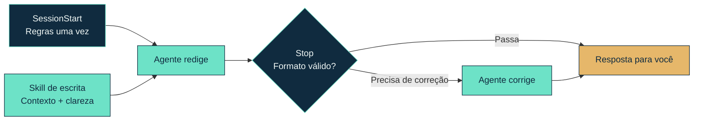

<!-- markdownlint-disable MD033 MD041 -->

<div align="center">


# Wellput

**Seus agentes trabalham em paralelo. Sua atenção, não.**

[](https://github.com/Castrozan/wellput/actions/workflows/verify.yml)
[](LICENSE)
[](#instalação)

[English](README.md) · **Português (Brasil)**

</div>

<!-- markdownlint-enable MD033 MD041 -->

Wellput é um **hook e uma skill de escrita** que tornam as respostas de fim de turno mais fáceis de **entender e agir sobre**. Reconheça a sessão, veja o que foi feito, saiba se você é necessário e siga em frente sem reler a conversa inteira.

> Feito para **sessões livres**: descoberta e entrega de alto risco, não workflows predefinidos.

A questão não é só ter _respostas mais curtas_. É colocar no agente a responsabilidade de tornar o trabalho compreensível, para que você consiga trabalhar em dezenas de sessões sem precisar dar atenção total a cada uma.


[Assista ao tour narrado](https://github.com/user-attachments/assets/70519b32-bcfe-4e2d-b427-6a866af8dd38)

## Instalação

Requer Python 3.12+ como `python3`. As dependências de runtime vêm empacotadas.

### Claude Code

```text
/plugin marketplace add Castrozan/wellput
/plugin install wellput@wellput
```

### Codex

```sh
codex plugin marketplace add Castrozan/wellput
codex plugin add wellput@wellput
```

Revise e confie nos hooks quando solicitado e depois inicie uma nova sessão.

## Como funciona

A resposta de fim de turno é tudo o que você lê. Ela deve tornar o trabalho compreensível sem te mandar de volta para a conversa.

**A skill guia a escrita. O hook garante o formato.**



## O formato da resposta

**Uma confirmação não deveria virar um relatório. Respostas mais longas devem te trazer de volta para a sessão.**

| #   | Resposta | Orçamento de prosa                         | Encerramento                        |
| --- | -------- | ------------------------------------------ | ----------------------------------- |
| 1   | Curta    | 100 palavras + 10 palavras de tolerância   | Sem rótulos obrigatórios            |
| 2   | Longa    | Orçamentos separados de corpo e fechamento | Os três blocos de fechamento abaixo |

| #   | Bloco de fechamento              | O que você recebe                                                       |
| --- | -------------------------------- | ----------------------------------------------------------------------- |
| 1   | **What is this session about?:** | O assunto e o objetivo da sessão, além do último passo.                 |
| 2   | **Done:**                        | O que de fato mudou ou foi estabelecido.                                |
| 3   | **Next:**                        | Trabalho restante, bloqueios ou a confirmação de que o trabalho acabou. |

Rótulos em negrito, ordem consistente e orçamentos de palavras independentes deixam o resumo fácil de encontrar.

**Às vezes o parágrafo mais claro é um diff.** Para uma mudança exata em `release.yaml`:

```diff
- retry_limit: 10
+ retry_limit: 3
```

Use tabelas, diagramas e código quando eles pouparem trabalho de quem lê. Visuais e blocos de código não contam no orçamento de prosa.

### Outras regras

| #   | Verificação      | O que você ganha                                                                                                           |
| --- | ---------------- | -------------------------------------------------------------------------------------------------------------------------- |
| 1   | Listas e tabelas | No máximo 5 itens ou linhas de dados, a menos que você peça uma tabela; linhas numeradas para respostas como “sobre o #2”. |
| 2   | Navegação        | Links diretos para os PRs e MRs citados.                                                                                   |
| 3   | Abertura         | A resposta primeiro, sem reações nem narração.                                                                             |
| 4   | Pontuação        | Sem travessões nem meias-riscas fora de citações; configurável.                                                            |

## Configuração

| #   | Quando                                    | Arquivo de configuração                           |
| --- | ----------------------------------------- | ------------------------------------------------- |
| 1   | `WELLPUT_CONFIG` está definido            | Seu caminho absoluto; substitui os locais padrão. |
| 2   | Senão, se `XDG_CONFIG_HOME` está definido | `$XDG_CONFIG_HOME/wellput/config.json`            |
| 3   | Senão                                     | `~/.config/wellput/config.json`                   |

Copie `wellput.json` para o caminho aplicável e depois altere orçamentos, rótulos, verificações ou o feedback de correção.

## Licença

Wellput é [licenciado sob MIT](LICENSE). As dependências Markdown empacotadas mantêm suas próprias [licenças](hooks/vendor/licenses).
